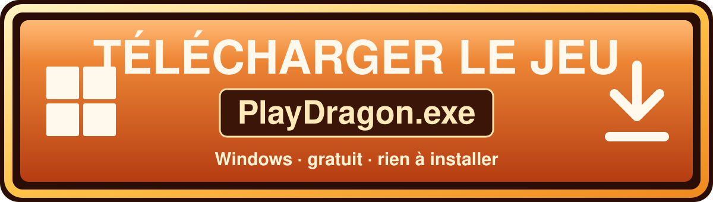
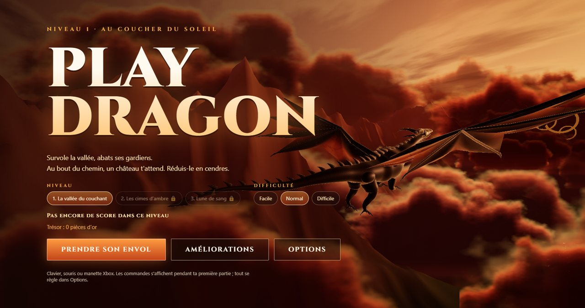
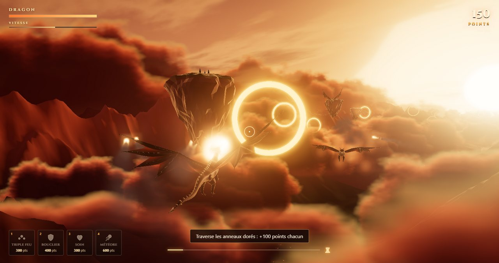

<h1 align="center">PlayDragon</h1>

<p align="center">
  <a href="https://github.com/raphaelmounirprivate-dot/PlayDragon/releases/latest/download/PlayDragon-Setup.exe">
    
  </a>
</p>

<p align="center">
  <b><a href="https://github.com/raphaelmounirprivate-dot/PlayDragon/releases/latest/download/PlayDragon-Setup.exe">⬇ Télécharger l'installeur (PlayDragon-Setup.exe)</a></b>
  &nbsp;·&nbsp;
  <a href="https://github.com/raphaelmounirprivate-dot/PlayDragon/releases/latest/download/PlayDragon.exe">version portable sans installation</a>
  &nbsp;·&nbsp;
  <a href="https://github.com/raphaelmounirprivate-dot/PlayDragon/releases/latest">toutes les versions</a>
</p>

<p align="center">
  
</p>

Un dragon survole une vallée au coucher du soleil, au-dessus d'une mer de nuages. Traverse les anneaux de
lumière, abats les gargouilles et évite les rochers flottants. Au bout du chemin, un château t'attend :
réduis-le en cendres avant que ses tours ne t'abattent.

## Installer

1. Clique sur **Télécharger le jeu** ci-dessus.
2. Lance `PlayDragon-Setup.exe`. Le jeu n'est pas signé, donc Windows SmartScreen peut afficher
   « Windows a protégé votre ordinateur » : clique sur **Informations complémentaires**, puis
   **Exécuter quand même**.
3. Suis l'installeur. Il crée un raccourci **PlayDragon** sur le bureau et dans le menu Démarrer. Pour
   désinstaller : Paramètres › Applications.

Tu préfères ne rien installer ? Prends la **version portable** (`PlayDragon.exe`) et lance-la directement.

<p align="center">
  
</p>

## Jouer

| Clavier (AZERTY) | Manette Xbox | Action |
|---|---|---|
| **Z Q S D** ou flèches | Stick gauche / croix | Diriger le dragon |
| Souris | Stick droit | Viser |
| **Clic** ou **Espace** | **RT** | Cracher une boule de feu |
| **E** (ou Maj) / **A** | **RB** / **LT** | Accélérer / freiner |
| **1 2 3 4** ou boutons en bas à gauche | **X Y B LB** | Pouvoirs spéciaux, payés avec tes points |
| **Entrée** | **A** | Valider (menus) |
| **Échap** | **Start** | Pause |
| **M** | | Couper / remettre le son |
| **F11** | | Plein écran |

### Niveaux et difficulté

Choisis le niveau et la difficulté dans le menu. Gagner un niveau débloque le suivant.

| Niveau | Ambiance | Château |
|---|---|---|
| 1. La vallée du couchant | Coucher de soleil, mer de nuages | Fort à 6 tours, 4 arbalétriers |
| 2. Les cimes d'ambre | Lumière dorée, hautes montagnes | Citadelle à 8 tours, 6 arbalétriers, un mage |
| 3. Lune de sang | Nuit étoilée sous une lune rouge | Forteresse à 8 tours, 8 arbalétriers, un mage |

**Facile**, **Normal** ou **Difficile** changent les dégâts que tu prends, le nombre d'ennemis, leur
résistance et leur cadence de tir. Ton **meilleur score** est sauvegardé pour chaque niveau et chaque
difficulté.

### Déroulement

1. **Le voyage** (environ 1 minute) : le dragon suit la rivière. Chaque anneau traversé rapporte
   100 points. Les rochers enlèvent 20 points de vie ; tu peux aussi les détruire en tirant dessus.
2. **Le Gardien de pierre** barre la route avant le château : le voyage s'arrête tant qu'il n'est pas
   vaincu. Esquive ses rochers et sa charge (il se met à trembler juste avant).
3. **Le siège** : le château apparaît. **Q / D** pour en faire le tour (le dragon reste face à lui),
   **Z / S** pour monter ou descendre. Chaque tour ou donjon détruit rapporte 500 points.
4. **La victoire :** quand tout est détruit, les remparts s'effondrent.

### Ennemis

| Ennemi | Où | Comment il attaque | Points |
|---|---|---|---|
| Gargouille | Voyage | Fonce sur toi (10 dégâts au contact) | 150 |
| Gargouille cracheuse | Voyage | Garde ses distances devant toi et crache des pierres | 200 |
| Chauves-souris | Voyage | Essaim qui tourne autour de toi, gêne la vue et mord. Une flamme suffit, une explosion en tue plusieurs | 25 |
| Wyverne | Voyage | Arrive par-derrière et mord, puis te double et vole devant toi : c'est le moment de la brûler | 300 |
| Gardien de pierre | Fin du voyage | Mini-boss avec barre de vie : rochers et charge | 2000 |
| Arbalétriers | Remparts | Tirent des carreaux enflammés | 100 |
| Mage | Donjon | Protège le donjon d'un dôme magique tant qu'une tour tient, et lance des orbes qui te suivent | 400 |
| Tours | Château | Tirent des éclairs bleus | 500 |

### Pouvoirs spéciaux

Tes points sont aussi ta monnaie. Chaque pouvoir a un temps de recharge.

| Touche | Pouvoir | Coût | Effet |
|---|---|---|---|
| 1 | Triple feu | 300 | Pendant 8 s, chaque tir part en éventail de 3 boules de feu |
| 2 | Bouclier | 400 | Invulnérable pendant 6 s |
| 3 | Soin | 300 | Rend 40 points de vie |
| 4 | Météore | 600 | Une énorme boule de feu qui inflige 4 dégâts au château |

## Développer

Il faut Node.js 20 ou plus récent.

```bash
npm install
npm run dev          # http://localhost:5173
npm test             # tests unitaires
npm run dist         # produit release/PlayDragon-Setup.exe (installeur) et release/PlayDragon.exe (portable)
```

Les règles du projet, son architecture et les pièges d'installation sont décrits dans
[AGENTS.md](AGENTS.md).

## Technique

- **Three.js**, tout est procédural : aucune image, aucun modèle 3D, aucun fichier son externe.
- **Ciel :** en shader, avec soleil ou lune, nuages et étoiles. Chaque niveau a sa palette.
- **Relief :** en bruit fractal, avec une vallée creusée le long de la rivière.
- **Dragon et ennemis :** sculptés par code (sections le long de courbes, lames courbes). Les ailes
  membraneuses se déforment à chaque battement.
- **Sons et musique :** synthétisés en direct avec la Web Audio API. La musique originale, en ré mineur,
  devient plus intense au combat.
- **Post-traitement :** bloom, étalonnage chaud, vignettage, tone mapping ACES.
- **Electron** pour l'exe Windows. La manette passe par la Gamepad API.
